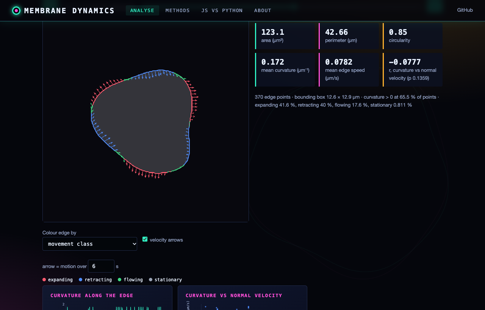
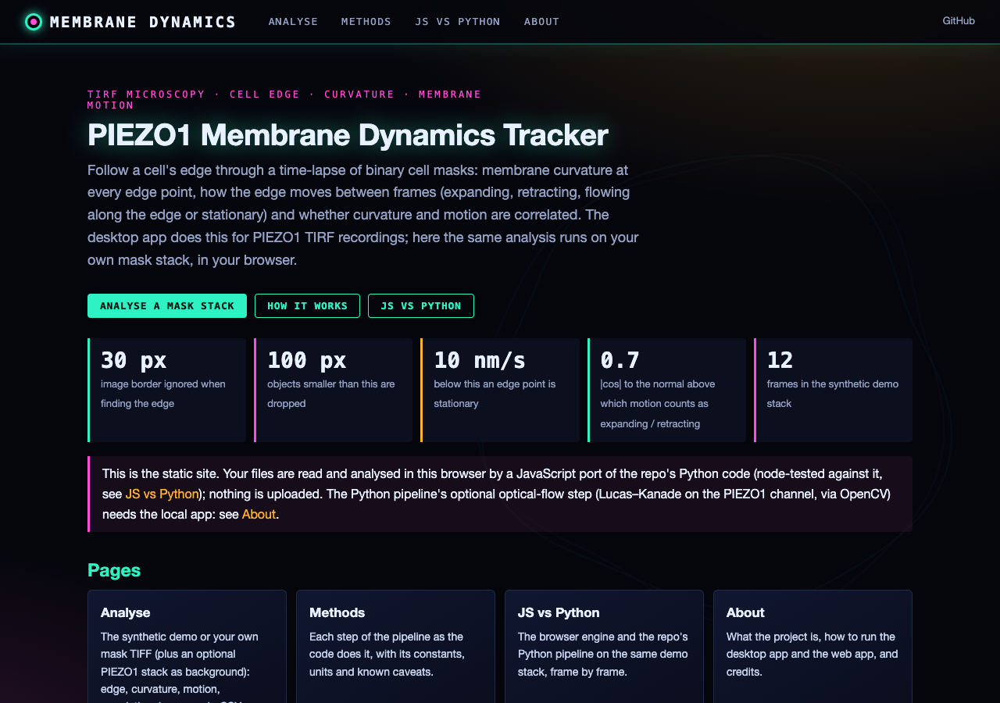
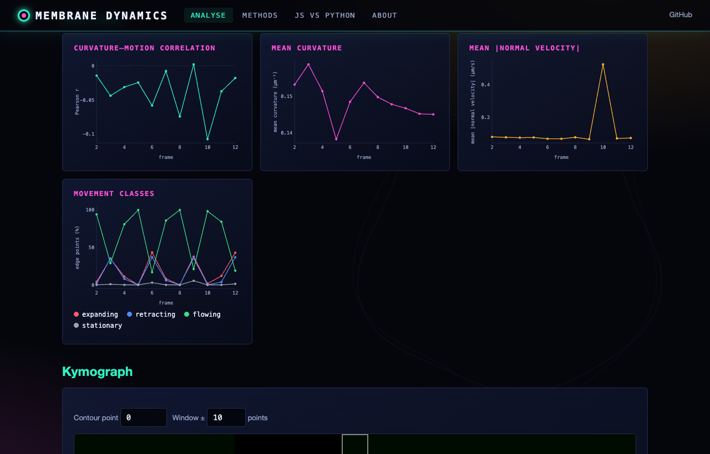
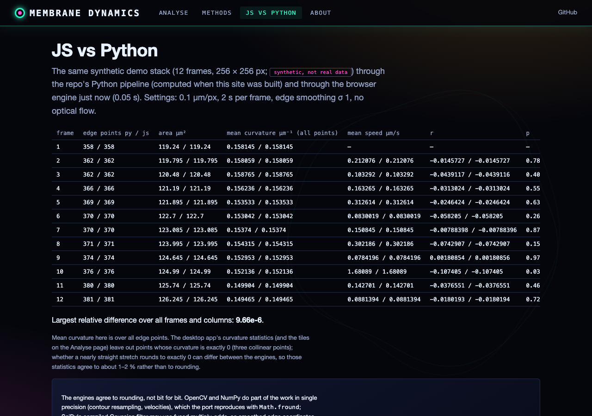

# PIEZO1 Membrane Dynamics Tracker

A Python-based application for analyzing PIEZO1 protein distribution and membrane dynamics using TIRF microscopy data.



## Overview

This tool enables simultaneous analysis of membrane dynamics, curvature, and PIEZO1 protein distribution along cell edges using Total Internal Reflection Fluorescence (TIRF) microscopy data. It processes two types of image sequences:

1. Binary segmented images showing cell position (cell mask)
2. Fluorescence recordings of PIEZO1 protein distribution

The application provides a powerful interface for investigating the relationship between membrane movement, curvature, and protein localization.

## Features

### Dynamics Analysis
- Tracks membrane movement between consecutive frames
- Classifies movement as expanding, retracting, flowing, or stationary
- Calculates velocity vectors and movement magnitudes
- Visualizes movement patterns with color-coded vectors

### Curvature Analysis
- Calculates local membrane curvature using circular arc fitting
- Maps curvature along the entire cell edge
- Correlates curvature with membrane dynamics and protein intensity
- Supports multiple curvature calculation methods

### Temporal Analysis
- Processes entire time-series sequences
- Creates kymographs to track specific membrane regions over time
- Analyzes correlation coefficients across frames
- Tracks movement class distributions throughout sequences

### Visualization Options
- Multi-tab interface with specialized views
- Real-time visualization updates when changing parameters
- Color-coding for different movement types and curvature values
- Export options for data and figures

## Installation

1. Clone the repository:
```bash
git clone https://github.com/yourusername/piezo1-dynamics-tracker.git
cd piezo1-dynamics-tracker
```

2. Create and activate a virtual environment (recommended):
```bash
python -m venv venv
source venv/bin/activate  # On Windows: venv\Scripts\activate
```

3. Install dependencies:
```bash
pip install -r requirements.txt
```

## Dependencies

- Python 3.8+
- NumPy
- OpenCV (cv2)
- SciPy
- Matplotlib
- PyQt6
- scikit-image
- pandas

## Usage

### Starting the Application

Run the application using:

```bash
python main.py
```

### Loading Data

1. Click "Load Cell Mask Sequence" to select the first frame of your binary cell mask sequence
2. Click "Load PIEZO1 Sequence" to select the first frame of your PIEZO1 fluorescence sequence

The application supports:
- Multi-page TIFF files
- Sequences of individual TIFF files with sequential numbering

### Analysis Parameters

- **Pixel Size**: Set the physical pixel size in nanometers (typically 100-200 nm)
- **Time Between Frames**: Set the time interval in seconds between frames
- **Edge Smoothing**: Adjust the Gaussian smoothing of the detected edge
- **Frame Range**: Select specific frames for analysis (useful for large datasets)

### Analysis Process

1. Navigate to desired frame using the frame slider or buttons
2. Adjust analysis parameters as needed
3. Click "Run Analysis" to process selected frames
4. View results in various visualization tabs

### Visualization Modes

- **Main View**: Change display mode between:
  - Original: Raw image data
  - Cell Mask: Binary segmentation
  - Optical Flow: Movement vectors between frames
  - Curvature-Motion: Curvature mapped to color with motion vectors
  - Movement Classification: Membrane segments colored by movement type

- **Correlation Analysis**: Plots of curvature vs. velocity with statistical analysis
- **Time Series**: Temporal plots of correlation, curvature, and movement classes
- **Kymograph**: Time-position plots for tracking membrane regions over time

### Exporting Results

- **Export Data to CSV**: Save all analysis data to a CSV file for further processing
- **Export Figures**: Save current visualizations as high-resolution images

## Technical Details

### Movement Classification

The application classifies membrane movement into four categories:

- **Expanding**: Outward movement (red)
- **Retracting**: Inward movement (blue)
- **Flowing**: Tangential movement along the membrane (green)
- **Stationary**: Minimal movement (gray)

Classification is based on the angle between velocity vectors and membrane normal vectors, along with magnitude thresholds.

Edge points are matched between consecutive frames by arc-length-aligned correspondence: each point of the current
edge is paired with the previous edge at the same fraction of the perimeter, shifted by the start-point offset that
minimises the distance between matched points. (Until November 2026 points were paired by index from each edge's own
start point, which made many points look "flowing"; results from earlier versions therefore have higher flowing
fractions, e.g. 66 % vs 19 % on the synthetic demo stack of the web interface.)

### Curvature Calculation

Curvature is calculated using:

1. **Finite Difference**: Direct calculation from coordinate derivatives
2. **Circle Fit**: Fitting circular arcs to membrane segments
3. **Spline**: Fitting and analyzing smooth spline curves

The curvature sign convention is:
- Positive curvature: membrane convex, bulging outward (a round cell is positive everywhere)
- Negative curvature: membrane concave, indented toward the cell interior

The sign does not depend on the order of the contour points.

### Optical Flow Analysis

Membrane motion is tracked using:

1. **Lucas-Kanade optical flow** for precise point tracking
2. **Contour correlation** between frames
3. **Normal vector projection** for movement classification

## Advanced Features

### Border Handling

The application automatically excludes image borders from analysis to prevent artifacts. Mask pixels within 30 pixels of the image edges are ignored when the cell edge is detected (`EdgeDetector.detect_edge`).

### Multi-frame Analysis

Process entire sequences with:
- Batch mode for analyzing multiple frames
- Range selection for processing specific subsets
- Progress tracking for long operations

### Correlation Analysis

Investigate relationships between:
- Curvature and normal velocity

Correlating curvature and movement class with PIEZO1 intensity along the edge is planned but not yet implemented: the
PIEZO1 sequence is currently used for the Lucas-Kanade optical flow that refines the edge velocities.

## Example Workflow

1. Load cell mask and PIEZO1 sequences
2. Set correct pixel size and time interval
3. Adjust edge smoothing parameter
4. Select a range of frames (e.g., frames 10-30)
5. Run analysis
6. Explore the different visualization tabs
7. Identify regions of interest and track their behavior
8. Export results for publication or further analysis

## Troubleshooting

- **No contour detected**: Adjust binary mask or check image format
- **Missing motion data for first frame**: Normal, as motion requires two frames
- **Border artifacts**: Increase the border margin (30 px) in `src/analysis/edge_detection.py` if needed
- **Performance issues**: Reduce frame range, use fewer sample points

## Web interface

**Live site:** https://gddickinson.github.io/cell_membrane_dynamics/

The same analysis runs in a web page on your own cell-mask TIFF stack (plus an optional PIEZO1 stack): cell edge,
curvature (µm⁻¹), edge motion (µm/s) and movement classes, the curvature / normal-velocity correlation per frame,
a kymograph and CSV export, with the pixel size in µm/px (read from ImageJ/OME metadata when the file has it) and the
frame interval in s. On the static site everything runs in the browser through a JavaScript port of
`src/analysis/` (node-tested against the Python code; see the "JS vs Python" page); files are not uploaded. A
synthetic demo stack (`src/web/demo_data.py`, clearly labelled, not real data) is included.

### Run the web app

```bash
pip install -r requirements.txt -r requirements-web.txt
python run_web.py          # http://127.0.0.1:8148
```

The local app adds a Python engine (the repo's own `src/analysis/pipeline.py`), including the Lucas–Kanade optical
flow on the PIEZO1 stack and compressed TIFFs. Tests: `python -m pytest -q tests` (includes the node tests of the JS
ports). Static build: `python scripts/build_static.py` (published by `.github/workflows/pages.yml`).

| Home | Analyse | Over time | JS vs Python |
|---|---|---|---|
|  |  |  |  |

## License

This project is licensed under the MIT License - see the LICENSE file for details.

## Acknowledgments

This tool was developed for analyzing PIEZO1 mechanosensitive ion channel distribution in relation to membrane dynamics and curvature in TIRF microscopy data.

## Contact

For questions and support, please open an issue on the GitHub repository.


---
*Built with AI assistance from [Claude (Anthropic)](https://claude.com/).*
